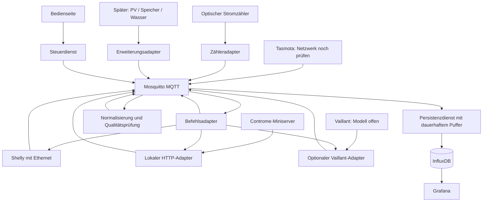

# Energiemanagementsystem für das Haus

Stand: 19.10.2026 · Konzept und Implementierungsstrategie, aktualisiert nach den ergänzten Rahmenbedingungen.

> Vom Nutzer übergebenes Anforderungsdokument (Originaldatei: `Energiemanagementsystem_Konzept.md`).
> Die Umsetzung dazu steht in `Umsetzungskonzept.md`.

## 1. Ziel und verbindliche Rahmenbedingungen

Das System visualisiert Energieströme, dokumentiert Stromverbrauch und Heizleistung und ermöglicht nachvollziehbare, abgesicherte Schalthandlungen. Die zentrale Voraussetzung ist ein herstellerunabhängiges Datenmodell für Strom, Wärme und Wasser. Vaillant wird bereits architektonisch berücksichtigt; Photovoltaik wird später ergänzt.

Alle neu eingeführten Softwaredienste laufen in Docker-Containern und werden über Docker Compose verwaltet. Vorhandene Gerätefirmware, Controme-Miniserver, Heizungsregler und physische Leseköpfe bleiben externe Geräte. Die eigentliche Heizungsregelung muss unabhängig vom EMS weiterarbeiten.

### Bestätigt und übernommen

| Punkt | Festlegung |
|---|---|
| Server | Vorhandener Linux-Server mit Docker und GPU |
| Netzwerk | Zunächst ausschließlich LAN; keine öffentliche Erreichbarkeit erforderlich |
| Stromzähler | Vorhandener Zähler mit optischer Schnittstelle; Modell und Protokoll noch unbekannt |
| WP | Bedeutet Wärmepumpe; damit ist die vorherige Lesefrage geklärt |
| Messstellen | Abgrenzung von Haus, WP und Gartenhaus wird später festgelegt |
| Shelly | Modelle offen; lokale MQTT-Anbindung vorgesehen |
| Controme | Miniserver vorhanden; Version und API-Freischaltung zu prüfen |
| Vaillant | Genaues System wird noch festgelegt |
| PV | Spätere Erweiterung |
| Bedienung | Visualisierung, Dokumentation und abgesicherte Schaltmöglichkeiten wie beschrieben |

Die GPU wird für Erfassung, MQTT, Datenbank und Grafana nicht benötigt. Eine GPU-Zuweisung an Container ist zunächst nicht vorgesehen. CPU, Arbeitsspeicher, freie SSD-Kapazität und Auslastung des vorhandenen Servers sind noch zu erfassen; eine Neuanschaffung wird nicht vorausgesetzt.

### Abgleich mit dem maßgeblichen Foto

Das Foto fordert MQTT, InfluxDB, Grafana, einen REST-Monitor und standardisierte Bezeichnungen unter Berücksichtigung der Medien. Die frühere Zusammenfassung „Strom WW“ wich von der nun bestätigten Angabe „Strom WP“ ab: Geplant wird Wärmepumpenstrom. Ein separater Warmwasserstromkreis wird nicht als vorhanden angenommen. Warmwasser bleibt ein möglicher Verwendungszweck innerhalb der Wärmepumpe.

Der Name der Steckdosen vor „Sockets mit Tasmota“ ist im Foto nicht sicher lesbar; „Farail“ bleibt unbestätigt. Entscheidend sind die tatsächliche Hardware und Firmware. Docker, Vaillant und die spätere PV erweitern die sichtbaren Bildanforderungen gemäß Nutzerauftrag.

„LAN“ wird vorerst als kabelgebundenes Ethernet ausgelegt. WLAN-Steckdosen sind dadurch nicht automatisch integrierbar; diese offene Abhängigkeit ist am Ende aufgeführt.

## 2. Architektur und Datenfluss



Die Adapter erfassen Rohdaten; die Normalisierung ordnet ihnen fachliche Bedeutung und Einheiten zu. Der Persistenzdienst verarbeitet ausschließlich normalisierte Topics. Die Normalisierung liest keine eigenen Ausgabetopics, damit keine Schleife entsteht. Befehlsadapter abonnieren getrennte Befehlstopics. Rückmeldungen werden wieder normalisiert.

Grafana ist die zentrale Analyseoberfläche. Eine kleine Bedienseite übernimmt Schaltaufträge mit Anmeldung und Rollenprüfung. Direkte Gerätezugangsdaten werden nicht in Grafana-Dashboards hinterlegt. Automatische Regeln verwenden denselben Steuerdienst wie manuelle Aufträge.

## 3. Docker- und Betriebskonzept

### Dienste und persistente Daten

| Compose-Dienst | Aufgabe | Persistenz / Konfiguration |
|---|---|---|
| `mosquitto` | MQTT-Broker | Volume unter `/mosquitto/data`; ACL, Brokerkonfiguration und Zertifikate schreibgeschützt |
| `meter-adapter` | Optische Zählerdaten nach MQTT | Modell-/Protokollkonfiguration, optional Zustand |
| `controme-adapter` | Lokales HTTP-Polling, später freigegebene Schreibbefehle | Endpunkte, Geheimnisse, Adapterzustand |
| `normalizer` | Mapping, Einheiten, Qualität, Duplikate | Mapping-Dateien schreibgeschützt; Zustandsvolume |
| `writer` | Zeitreihen und Ereignisse speichern | Persistenter, begrenzter Puffer bei Datenbankausfall |
| `influxdb` | Messwerte und Ereignisse | `/var/lib/influxdb2`, `/etc/influxdb2` |
| `grafana` | Dashboards und Auswertung | `/var/lib/grafana`; provisionierte Dashboards/Datenquelle |
| `controller` | Befehlsprüfung, Regeln, Audit | Befehlsjournal, Regelzustand |
| `control-ui` | Authentifizierte Bedienung | Rollen- und Anwendungskonfiguration |
| `rest-monitor` | APIs und Datenalter prüfen | Prüfplan und Endpunkte |
| `proxy` | HTTPS im LAN | Zertifikate und Routing |
| `backup` | Sicherung und Aufbewahrung | Separates Sicherungsziel |
| `scheduler` | Containerinterne Zeitplanung für Backups/Aggregation | Zeitplan und Jobzustand |
| Optional: `ebusd` / EEBUS-Adapter | Vaillant-Anbindung nach Modellprüfung | Definitionen, Verbindung oder Pairing |
| Später: `pv-adapter` | Wechselrichter-/Speicherdaten | Gerätekonfiguration |

Der Kern startet ohne Vaillant- oder PV-Adapter. Compose-Profile wie `vaillant` und `pv` aktivieren spätere Erweiterungen. Individuelle Adapter und Steuerdienste sind noch zu implementierende Software, keine hier bereits installierten Produkte.

### Netzwerke und Ports

- `frontend`: Proxy, Grafana, Bedienseite. Veröffentlichung von HTTPS ausschließlich an der vorgesehenen LAN-IP des Linux-Servers.
- `backend`: internes Docker-Netz für Datenbank, Broker, Normalisierung, Writer und Steuerdienst. InfluxDB erhält keinen veröffentlichten Host-Port.
- `device_access`: Adapter mit LAN-Zugang zu festgelegten Geräteadressen. Router-/Host-Firewall begrenzt Verbindungen; ein Docker-Bridge-Netz allein stellt keine ausreichende Zieladressfilterung dar.
- MQTT wird an der LAN-IP veröffentlicht: bevorzugt 8883 mit TLS. Port 1883 nur für Geräte, die TLS nicht beherrschen, mit Zugangsdaten und beschränktem Netz-/Gerätezugriff.
- Keine Portweiterleitung am Internetrouter. Fernzugriff ist aktuell nicht vorgesehen.
- EEBUS benötigt gegebenenfalls Multicast-Erkennung. Eine dafür nötige Netzwerksonderlösung wird ausschließlich beim betreffenden Adapter eingerichtet und zuvor getestet.

Geräte erhalten feste DHCP-Zuordnungen. Geräte und Server benötigen eine zuverlässige Zeitquelle. Zeitstempel werden in UTC gespeichert und in Grafana mit Europe/Berlin angezeigt. Keine Cloud ist für den Kernbetrieb erforderlich; Aktualisierungen und gegebenenfalls spätere Herstellerdienste sind gesonderte externe Verbindungen.

### Images, Secrets und Neustarts

Images werden auf geprüfte Versionen/Digests festgelegt; kein `latest`. Für den ersten Ausbau bleibt InfluxDB OSS 2 eine bewusste Architekturentscheidung. Vor Installation sind ein gepflegter Patchstand und dessen Eignung zu prüfen. Eine Umstellung auf Version 3 wird als eigene Migration behandelt; das Docker-Tag `latest` verweist inzwischen auf InfluxDB 3. [InfluxDB-Versionierung](https://docs.influxdata.com/influxdb3/)

Zugangsdaten kommen über Compose-Secrets aus geschützten Hostdateien. Diese sind keine automatisch verschlüsselten Geheimnisspeicher. Grafana bekommt nur Leserechte, der Writer Schreibrechte auf die vorgesehenen Buckets. Geräte erhalten individuelle MQTT-Konten und Topic-ACLs. Gesundheitsprüfungen, Wiederverbindung mit zunehmender Wartezeit, begrenzte Logs und `restart: unless-stopped` sind verbindlich. Startreihenfolge ersetzt keine Wiederverbindungslogik. [InfluxDB-Compose-Dokumentation](https://docs.influxdata.com/influxdb/v2/install/use-docker-compose/)

Container arbeiten soweit möglich ohne Root, ohne privilegierten Modus und ohne Docker-Socket. Nur der Zähleradapter bekommt den benötigten USB-Gerätezugriff. Die GPU bleibt unzugewiesen. Ressourcenlimits verhindern, dass andere Serveraufgaben das EMS oder umgekehrt beeinträchtigen.

## 4. Zähler mit optischer Schnittstelle

Eine optische Schnittstelle bestimmt das Protokoll noch nicht. SML, IEC-62056-21 und andere Varianten dürfen nicht allein aus „Standardzähler“ abgeleitet werden. Auch ein zusätzlicher optischer Impulsausgang ist nicht mit einer Datenschnittstelle gleichzusetzen.

Vorgehen:

1. Hersteller und Modell, Schnittstellenkennzeichnung und zugängliche Daten erfassen.
2. Prüfen, ob PIN/Freischaltung beziehungsweise erweiterte Datenausgabe erforderlich ist.
3. Passenden optischen Lesekopf wählen: bei erreichbarem Server USB, andernfalls Ethernet-Gateway als Hardwareadapter. Für die aktuelle LAN-Vorgabe keinen WLAN-Lesekopf voraussetzen.
4. Erst nach Protokollnachweis die Reader-Software für den Container festlegen.
5. Bei USB den stabilen Hostpfad `/dev/serial/by-id/...` verwenden und gezielt in den Adaptercontainer einbinden.
6. Telegramme mit Zähleranzeige vergleichen; Einheit, Skalierung, Richtung und Zeitbezug bestätigen.

Typische Mapping-Kandidaten sind OBIS `1-0:1.8.0` für Bezugsenergie und `1-0:2.8.0` für Einspeiseenergie. Ob sie tatsächlich vorhanden sind, muss am konkreten Zähler geprüft werden. Leistungswerte werden erst nach Prüfung von Code, Vorzeichen und Einheit übernommen.

## 5. Shelly: recherchierte technische Grundlagen und MQTT

Die konkreten vorhandenen Shellys sind unbekannt. Daher ist die folgende Auswahl eine technische Orientierung für den LAN-Ausbau, keine Behauptung über den Gerätebestand und keine Einkaufsliste.

### Geeignete Ethernet-Kandidaten

| Gerät | Nachgewiesene Merkmale | Rolle im Konzept |
|---|---|---|
| Shelly Pro 3EM, Modell SPEM-003CEBEU | Hutschiene, dreiphasige Messung, Ethernet, MQTT; bei dieser Variante 120-A-Stromwandler; Spannung, Strom, Wirk-/Scheinleistung und Energie pro Phase; mindestens 45 Tage lokale Minutenhistorie | Messung von dreiphasiger WP oder Stromkreisen, sobald Messgrenzen feststehen |
| Shelly Pro 1PM v.1, SPSW-201PE16EU | Hutschiene, Ethernet, MQTT, ein Schaltkanal mit Leistungsmessung; Versorgung 110–240 V AC, maximal 16 A AC laut Datenblatt | Geeigneter einzelner Stromkreis mit Messung und Schaltung nach Lastprüfung |
| Shelly Pro 1 | Ethernet und MQTT, potentialfreier Kontakt, keine Leistungsmessung | Freigegebener Steuereingang oder Schütz; für Verbrauchsdaten zusätzlicher Messpfad |

Quellen: [Pro 3EM](https://kb.shelly.cloud/knowledge-base/shelly-pro-3em), [Pro 1PM v.1](https://kb.shelly.cloud/knowledge-base/shelly-pro-1pm-v1), [Pro 1 Hersteller](https://www.shelly.com/products/shelly-pro-1), [Pro 1 technische Anleitung](https://kb.shelly.cloud/__attachments/391315459/Shelly%20Pro%201%20multilingual%20printed%20user%20and%20safety%20guide.pdf?inst-v=f0482410-4dba-4df6-a3b7-ae8e82eed03a).

Stromwandler-Messbereich und Relais-Schaltstrom sind unterschiedliche Eigenschaften. Pro-3EM-Varianten dürfen nicht miteinander verwechselt werden. Ein Messgerät wird nicht automatisch als Lastschalter behandelt. Die Eignung für Dauerlast, Anlaufstrom, Einbau und Schutzbeschaltung ist separat zu prüfen. Insbesondere wird eine Wärmepumpe nicht über einen gewöhnlichen Smart-Schalter hart vom Netz getrennt.

### Generationsabhängige Anbindung

**Gen1:** MQTT verwendet modellabhängige `shellies/...`-Topics. Die Dokumentation nennt kein MQTT-TLS und die Abschaltung der Shelly-Cloud bei aktiviertem MQTT. Einige Gen1-Zähler melden Energie in Wattminuten. Das muss im Mapping ausdrücklich berücksichtigt werden. [Gen1-API](https://shelly-api-docs.shelly.cloud/gen1/)

**Komponentenbasierte Geräte:** Die MQTT-Konfiguration umfasst Brokeradresse, Benutzer, Topic-Präfix und TLS-Einstellungen. Statusmeldungen und RPC sind separat schaltbar. TLS mit eigener CA ist dokumentiert; die Einstellung mit deaktivierter Zertifikatsprüfung wird nicht verwendet. Die Dokumentation beschreibt QoS 1; doppelte Nachrichten bleiben deshalb möglich. Generation und Firmware des konkreten Modells müssen zum API-Profil passen. [MQTT-Komponente](https://shelly-api-docs.shelly.cloud/gen2/ComponentsAndServices/Mqtt/)

### Einrichtungsablauf

1. Modell, Hardwareversion und Firmware in das Geräteverzeichnis aufnehmen.
2. Ethernet verbinden und feste DHCP-Zuordnung vergeben.
3. Broker-LAN-Adresse, gerätespezifischen MQTT-Benutzer und TLS mit vertrauenswürdiger CA konfigurieren, soweit unterstützt.
4. Eindeutiges Topic-Präfix und ACL festlegen. Gerätenative Topics werden vom Normalizer direkt gelesen; eine zusätzliche Rohdatenkopie ist optional.
5. Statusmeldungen aktivieren. Steuerfunktionen zunächst deaktivieren beziehungsweise über Broker-ACL sperren.
6. Verbindung, Messwerte, Wiederanlauf und Statusalter prüfen. Ein konfigurierter Benachrichtigungsmodus garantiert keine feste Messrate: fehlende regelmäßige Aktualisierung wird bei Bedarf durch gezielte Statusabfragen ergänzt.
7. Erst nach lesendem Abnahmetest Befehlsadapter freigeben.

Beispiele für Komponenten mit Leistungsmessung: `<prefix>/status/switch:0`, dort `apower` in W und `aenergy.total` in Wh. Dreiphasige Messgeräte verwenden eigene EM-/EMData-Komponenten; das Switch-Schema darf dort nicht pauschal angewendet werden. [Switch-Komponente](https://shelly-api-docs.shelly.cloud/gen2/ComponentsAndServices/Switch/), [EMData](https://shelly-api-docs.shelly.cloud/gen2/ComponentsAndServices/EMData/)

Für das Schalten werden eindeutige Zustandsbefehle, beispielsweise `Switch.Set` mit `on: true`, genutzt. Request-ID und Antwort werden korreliert; anschließend wird der tatsächliche Ausgangszustand gelesen. Geräteantwort und beobachtete Leistungswirkung sind getrennte Bestätigungen.

## 6. Controme: lokale API und Freischaltung

**Herstellerbelegt:** Die aktuelle API-Seite beschreibt lokale HTTP-Kommunikation. Die Freischaltung erfolgt durch Buchung des verlinkten Artikels mit MAC-Adresse. Version und Systeminformationen sind über `.../get/json/v1/<haus-id>/info/` vorgesehen. Messwerte liefert unter anderem `temps/`; temporäre Ziele setzt `.../set/json/v1/<haus-id>/ziel/<raum-id>/` per POST mit Zugangsdaten, `ziel` und `duration`. Controme nennt fehlende Zertifikate, keinen technischen API-Support und mögliche Änderungen bei Updates. [API-Dokumentation](https://support.controme.com/api/), [Aktivierungsartikel](https://shop.controme.com/produkt/controme-api-aktivierung-mini-server/)

Die ältere Meldung von 2017 nennt eine Freischaltung per E-Mail. Maßgeblich für die Planung ist der aktuelle Buchungsweg; eine vorhandene Freischaltung wird zuerst geprüft. App-Freischaltung und API-Lizenz sind unterschiedliche Themen. [Historische Meldung](https://www.controme.com/2017/04/neu-controme-api-zur-anbindung-von-drittsystemen/)

| Weg | Lesen / Steuern | Bewertung |
|---|---|---|
| Lokale API | Messwerte und begrenzte Sollwertänderungen | Empfohlen; mittlerer Aufwand, Versionsrisiko |
| Uniconnect | Controme greift als Client auf externe Modbus-/HTTP-Geräte zu | Kein belegter Controme-Modbus-Server |
| API Query | Miniserver-Verbund | Für EMS nicht bevorzugt |
| Natives MQTT | In geprüften Quellen nicht belegt | Nicht voraussetzen |

Quellen: [Uniconnect](https://support.controme.com/uniconnect/), [API Query](https://support.controme.com/api-query/).

**Umsetzung:** Lokaler Adapter, zunächst lesend im 60-Sekunden-Takt als Startannahme. Vorher LAN-Adresse, Version, Lizenz, Haus-ID, Räume und Antwortformate prüfen. Zugangsdaten aus Logs entfernen; Schreibzugriffe gesondert freigeben. Nach Updates gespeicherte Referenzantworten gegen das erwartete Schema prüfen. [Miniserver-Dokumentation](https://support.controme.com/mini-server/)

## 7. Einheitliches Datenmodell und Mapping

Jeder Messpunkt erhält eine stabile ID. Anzeigenamen dürfen geändert werden, ohne historische Zeitreihen umzubenennen. Medium, Messgröße, Messstelle und Verwendungszweck sind getrennt.

| Merkmal | Beispiel |
|---|---|
| `point_id` | `haus.gartenhaus.steckdose01.electricity.active_power` |
| `asset_id` | `garden_socket_01` |
| `medium` | `electricity`, `water`, `heat` |
| `quantity` | `active_power`, `energy_import_total`, `volume_total`, `temperature` |
| `circuit_id` | `unassigned` bis zur Zuordnung; später `heat_pump` oder `garden_house` |
| `unit` | `W`, `kWh`, `m3`, `m3/h`, `degC` |
| `direction` | Bezug, Einspeisung, Verbrauch oder Erzeugung |
| `measurement_kind` | gemessen, gerätegemeldet, geschätzt oder berechnet |
| Qualität / Herkunft | Messzeit, Empfangszeit, Datenalter, Quellschlüssel, Mapping-Version |

Strom WP und Strom Gartenhaus sind Stromkreise beziehungsweise Zwecke. Wasser und Wärme bleiben eigene Medien. Eine Raumtemperatur wird nicht allein durch ihre Nähe zur Heizung als thermische Leistung interpretiert.

### Mapping-Beispiele

| Quelle | Eingang | Standardmessgröße | Umrechnung / Vorbehalt |
|---|---|---|---|
| OBIS-Zähler | `1-0:1.8.0` | `electricity.energy_import_total` | Einheit und Skalierung im Telegramm prüfen |
| Shelly Gen1, z. B. 1PM | `relay/0/power` | `electricity.active_power` | W |
| Shelly Gen1, z. B. 1PM | `relay/0/energy` | `electricity.energy_consumption_total` | Wmin / 60000 = kWh; Resetverhalten beachten |
| Shelly Switch-Komponente | `apower` | `electricity.active_power` | W |
| Shelly Switch-Komponente | `aenergy.total` | `electricity.energy_consumption_total` | Wh / 1000 = kWh; Richtung modellabhängig prüfen |
| Tasmota mit Messhardware | `ENERGY.Power`, `ENERGY.Total` | Leistung, Energiezähler | Typisch W und kWh; am Firmwarepayload bestätigen |
| Controme | Raumtemperatur | `temperature`, Rolle `room_actual` | Zuordnung über stabile Raum-ID |
| Späterer Wasserzähler | Literzähler | `water.volume_total` | Liter / 1000 = m³ |

Tasmota-Quelle: [MQTT-Dokumentation](https://tasmota.github.io/docs/MQTT/). Firmware allein beweist keine vorhandene Leistungsmessung.

Das Mapping liegt als versioniertes YAML vor. Ein Beispielprofil, noch kein produktives Parserformat:

```yaml
profile: shelly_gen1_1pm
mapping_version: 1
source_topic: shellies/GERAETE_ID/relay/0/energy
target:
  asset_id: socket_01
  circuit_id: unassigned
  medium: electricity
  quantity: energy_consumption_total
  unit: kWh
conversion:
  source_unit: Wmin
  divisor: 60000
```

Topics des gemeinsamen Schemas:

```text
ems/v1/telemetry/<asset>/<quantity>
ems/v1/availability/<asset>
ems/v1/command/<asset>/request
ems/v1/command/<asset>/result
ems/v1/state/<asset>
```

Unbekannte Schlüssel werden isoliert und angezeigt. Fehlende Daten werden nicht zu null. UTC-Messzeit und Empfangszeit bleiben getrennt. Zählerrücksetzungen, Überläufe, Gerätewechsel und MQTT-Duplikate werden erkannt. Rohzähler und korrigierte Verbrauchsableitung bleiben nachvollziehbar getrennt.

In InfluxDB werden stabile Merkmale als Tags und Werte/Qualitätsinformationen als Felder modelliert. Hochvariable IDs wie einzelne Befehls-IDs werden nicht als Zeitreihen-Tags verwendet. Messgrößen mit unterschiedlichen Feldtypen erhalten getrennte, stabile Schemas.

## 8. Messgrenzen, Heizleistung und Vaillant

Bis zur Festlegung der Stromkreise werden Messpunkte erfasst, aber keine verbindlichen Haus-/WP-/Gartenhausbilanzen berechnet. Ein Unterzähler darf nicht zum bereits umfassenden Hauptzähler addiert werden. Die Zuordnung bekommt einen Gültigkeitsbeginn, damit spätere Umbauten historische Auswertungen nicht verfälschen.

Für Heizleistung werden geeignete thermische Messwerte benötigt. Raumtemperatur, Vorlauftemperatur oder Relaiszustand allein ergeben keine Heizleistung. Für belastbare Wärmemenge wird ein Wärmemengenzähler vorgesehen; Vor-/Rücklauf, Volumenstrom und Medium müssen passend erfasst werden. Elektrische WP-Energie umfasst eine ausdrücklich definierte Grenze einschließlich beziehungsweise ausschließlich Heizstab und Hilfsverbrauchern. Arbeitszahlen werden nur aus zusammenpassenden Zeiträumen und Messgrenzen berechnet.

### Vorbereitete Vaillant-Wege

- **EEBUS:** bevorzugter lokaler Weg für Energiekoordination, sofern das spätere System und ein geeigneter containerisierter Client die benötigten Anwendungsfälle unterstützen. Pairing, Netzwerk und Rückmeldungen werden vor Freigabe getestet.
- **eBUS / ebusd:** optionaler Container für zusätzliche Betriebsdaten mit passendem physischem Adapter und Gerätedefinitionen. Zunächst nur lesend. eBUS ist nicht EEBUS.
- **Cloud-API:** Vaillant beschreibt Partneranbindungen; ein frei nutzbarer eigener API-Zugang wird nicht angenommen.
- **SG-/PV-Ready:** mögliche begrenzte Betriebsanforderung über freigegebene Kontakte nach Prüfung des konkreten Modells. Keine Ersatzlösung für vollständige Messdaten.
- **Modbus:** nur mit modellbezogener Herstellerdokumentation und Registerbeschreibung vorsehen.

Vaillant nennt kompatible Regler und Internetmodule; Verfügbarkeit und Funktionsumfang hängen von der Kombination ab. Eine allgemeine Produktbeschreibung bestätigt keinen beliebigen EMS-Client. [Vaillant-Schnittstellen](https://www.vaillant.de/ratgeber/heizung-im-smart-home/smarte-schnittstellen/), [Vaillant PV/Wärmepumpe](https://www.vaillant.de/ratgeber/technologie-verstehen/waermepumpe/waermepumpe-mit-photovoltaik/), [ebusd-Compose und Lesemodus](https://github.com/john30/ebusd/blob/master/contrib/docker/docker-compose.example.yaml)

Vaillant regelt die Wärmeerzeugung; Controme regelt die Räume. Das EMS übermittelt begrenzte Optimierungsanforderungen. Mindestvolumenstrom und hydraulische Randbedingungen müssen unabhängig vom Öffnungszustand einzelner Räume gesichert sein. Mehrere gleichzeitig schreibende Energiemanager sind zu vermeiden.

## 9. Schalten und Rückmeldung

Jeder Auftrag enthält Befehls-ID, Ziel, Aktion, Auslöser und Ablaufzeit. Der Steuerdienst prüft Rollen, erlaubte Aktionen, Datenalter, Verfügbarkeit, Grenzwerte, Verriegelungen, manuelle Übersteuerung und Mindestlauf-/Pausenzeiten.

Zustandsfolge:

```text
angefordert -> freigegeben -> gesendet -> bestätigt -> Zustand beobachtet
                          -> abgelehnt / abgelaufen / fehlgeschlagen / unbekannt
```

Befehle sind niemals retained. Alte Aufträge werden nach Neustart nicht erneut ausgeführt. Eindeutige Sollzustände ersetzen `toggle`. MQTT-Bestätigung oder HTTP-Erfolg beweist noch keine physische Wirkung: Ausgangszustand und, soweit vorhanden, Leistungsänderung werden getrennt geprüft. Wiederholungen sind begrenzt und berücksichtigen Idempotenz.

Für jedes Gerät wird das Verhalten bei Netz-, Broker- und Serverausfall festgelegt. Bei veralteten Daten endet automatische Optimierung. Heizungsgrundfunktionen laufen lokal weiter; temporäre Änderungen werden bevorzugt mit geräteseitig wirksamer Ablaufzeit ausgeführt. Ein Softwaretimer im ausgefallenen EMS allein reicht nicht als Rückfallmechanismus.

Manuelle Übersteuerung hat definierte Priorität und Ablaufzeit. Komfort- und Temperaturgrenzen bleiben erhalten. Netzspannungsarbeiten, Schützauswahl und Schutzbeschaltung erfolgen durch eine Elektrofachkraft anhand der konkreten Last und Herstellerunterlagen.

## 10. PV und spätere Erweiterungen

PV, Batterie und Wasser sind im Datenmodell vorgesehen, aber zunächst als nicht installiert markiert. Es werden keine Nullwerte als vermeintliche Messungen erzeugt.

Später werden PV-Leistung/-Energie, Netzbezug/-einspeisung und gegebenenfalls Batterie-Ladung/-Entladung/-Ladezustand integriert. Dokumentierte lokale MQTT-, HTTP-, Modbus-TCP- oder SunSpec-Schnittstellen sind Auswahlkriterien, aber am konkreten Modell zu bestätigen.

Bei identischen AC-Messgrenzen gilt:

`Hausverbrauch = PV + Netzbezug + Batterieentladung - Einspeisung - Batterieladung`

DC-/AC-Werte von Hybridwechselrichtern dürfen nicht ungeprüft vermischt werden. Speicherverluste und nicht erfasste Verbraucher werden ausgewiesen.

PV-Regeln beginnen später im Beobachtungsmodus. Ein möglicher Startansatz ist mehrminütig stabiler Überschuss mit Leistungsreserve, Hysterese und gerätespezifischen Mindestlaufzeiten. Konkrete Schwellen werden erst anhand von PV, Lasten, Speichern und Komfortgrenzen festgelegt.

## 11. Visualisierung, REST-Monitor und Speicherung

Grafana-Ansichten:

1. Energiefluss mit Messgrenzen und Restverbrauch; bis zur Messstellenklärung als unvollständig gekennzeichnet.
2. Stromverbrauch pro Tag, Monat, Jahr und zugeordnetem Stromkreis.
3. WP: Strom, Wärme, Temperaturen, Zustände und später belastbare Arbeitszahlen.
4. Controme: Ist-/Solltemperaturen, Datenalter und verfügbare Ausgangszustände.
5. Betrieb: Schnittstellen, Pufferfüllung, Datenlücken und Befehlsjournal.

Der REST-Monitor prüft erfolgreiche Antworten, Antwortschema, Laufzeit und fachliches Datenalter. Ein HTTP-Status 200 mit alten Werten gilt nicht als gesunder Messpfad. Er löst keine Schaltaktion aus. Alarme erscheinen zunächst im LAN-Dashboard; externe Benachrichtigungsdienste sind nicht vorausgesetzt.

Startannahme für Aufbewahrung: Rohpayloads sieben Tage, Detaildaten zwölf Monate, Tagesaggregate mindestens zehn Jahre. Die Kapazitätsrechnung folgt dem Geräteinventar. Leistungswerte erhalten zeitgewichtete Auswertungen, Energie bevorzugt Zählerdifferenzen; Datenlücken und Abdeckungsgrade werden sichtbar. Fehlende Leistung wird nicht unbegrenzt fortgeschrieben.

Der Writer puffert Daten dauerhaft bei Datenbankausfall und meldet Kapazitätsgrenzen. MQTT-Persistenz ersetzt diesen Puffer nicht. Bei Broker- oder Geräteausfall können Werte ohne Quellpuffer fehlen. Eine lokale Gerätehistorie wird nur mit implementiertem, dedupliziertem Nachladeverfahren zur Lückenfüllung genutzt.

Backups umfassen konsistente Datenbanksicherungen, Mapping, Dashboards, Regeln, Journale und gegebenenfalls Pairing-Daten. Ein anderes Verzeichnis auf derselben SSD allein ist kein ausreichendes Sicherungsziel. Wiederherstellung wird in einem getrennten Compose-Projekt getestet.

## 12. Umsetzung in überprüfbaren Schritten

| Phase | Inhalt | Abnahme |
|---|---|---|
| 1 | Server- und Geräteinventar, LAN-Adressen | Ressourcen und erreichbare Geräte bekannt |
| 2 | Compose-Kern, ACLs, Secrets, HTTPS, Backup | Neustart und Wiederherstellung bestanden |
| 3 | Optischen Zähler identifizieren und anbinden | Einheiten und Anzeigevergleich plausibel |
| 4 | Je ein Shelly-/Tasmota-Profil lesend | Modell, Protokoll, Energieeinheit und Reset geprüft |
| 5 | Controme-Version und API prüfen, lesend anbinden | Antwortschema und Datenalter validiert |
| 6 | Mapping, InfluxDB und Grafana | Keine Doppelzählung; Lücken sichtbar |
| 7 | Stromkreiszuordnung nachreichen | Historisch gültige Messgrenzen dokumentiert |
| 8 | Unkritischen Verbraucher manuell schalten | Rückmeldung, Timeout und Verriegelung bestanden |
| 9 | Vaillant nach Modellfestlegung ergänzen | Schnittstellen und Wärmebilanz geprüft |
| 10 | Automatik zunächst nur protokollieren | Vorschläge nachvollziehbar und plausibel |
| 11 | Begrenzte Automatik, später PV | Ausfallverhalten und Regelgrenzen bestätigt |

Betriebstests umfassen Host-Neustart, Broker-/Datenbankausfall, LAN-Unterbrechung, USB-Wiederanschluss, veraltete Werte, Zählerreset, doppelte MQTT-Nachrichten und abgelaufene Befehle. Die Entwicklung erfolgt mit gespeicherten Beispielpayloads; reale Schreibzugriffe bleiben bis zur jeweiligen Abnahme gesperrt.

## 13. Offene Punkte – gebündelt und priorisiert

### Für den ersten lesenden Ausbau erforderlich

1. **Server:** Distribution, Architektur, Docker-/Compose-Version, CPU/RAM, freie SSD-Kapazität, konkurrierende Lasten und Sicherungsziel.
2. **LAN:** Server-IP, Geräte-IP/DHCP-Zuordnungen, vorhandene Segmente und Firewall. Bedeutet LAN strikt Ethernet für alle Geräte? Falls ja, können WLAN-only-Shellys und übliche Tasmota-Steckdosen zunächst nicht teilnehmen.
3. **Optischer Zähler:** Hersteller/Modell, Protokoll, PIN/Freischaltung, ausgegebene OBIS-Werte, vorhandener Lesekopf und Entfernung zum Server.
4. **Shelly/Tasmota:** Modelle, Hardwaregenerationen, Firmware, Ethernetfähigkeit und tatsächliche Messhardware. Erst danach sind verbindliche Topics und Messprofile festlegbar.
5. **Controme:** Miniserver-Hardware, Smart-Heat-OS-Stand, MAC-Adresse, lokale Adresse, vorhandene API-Lizenz, Haus-ID und aktive Module. Buchung nur falls erforderlich; keine Freischaltung wurde hier vorgenommen.

### Später festzulegen; blockiert den Grundaufbau nicht

6. **Messgrenzen:** Welche Geräte gehören zu Haus, WP und Gartenhaus? Wo sind Unterzähler enthalten? Wie werden Heizstab und Hilfsverbraucher abgegrenzt?
7. **Vaillant:** Außen-/Innengerät, Regler, Internetmodul, Firmware, Speicher, hydraulisches Schema und Wärmemengenzähler. Danach konkrete EEBUS-/eBUS-/Kontaktentscheidung.
8. **Schaltfreigaben:** konkrete Lasten, Benutzerrollen, Komfort-/Temperaturgrenzen, Mindestlaufzeiten und Rückfallzustände. Der grundsätzliche Ablauf ist definiert; konkrete elektrische Freigaben bleiben geräteabhängig.
9. **PV:** Wechselrichter, Speicher, Leistung und lokale Schnittstellen erst bei Erweiterung festlegen.
10. **Aufbewahrung:** Startannahmen bestätigen und aus tatsächlicher Datenmenge Speicherbedarf sowie Puffergröße ableiten.

## 14. Status und nächste konkrete Arbeit

Dieses Dokument ist das aktualisierte Architektur- und Umsetzungskonzept. Es enthält recherchierte Herstellerangaben und ausdrücklich markierte Planungsannahmen. Es wurden keine Dienste auf dem Linux-Server installiert und keine Geräte oder API-Lizenzen verändert.

Der nächste Umsetzungsschritt ist das Geräteinventar mit je einem Beispieltelegramm pro Quelle. Darauf basieren die konkreten Adapterprofile und anschließend ein prüfbares Compose-Paket mit Konfigurationen, ACLs, Mapping, Datenbankinitialisierung und Grafana-Provisionierung.
